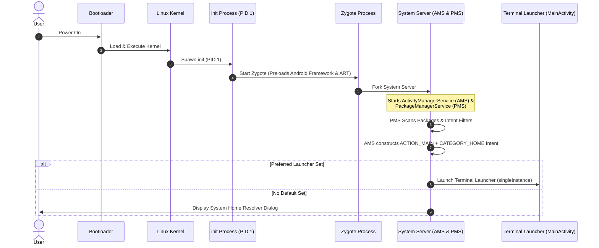

# 📖 Chapter 1: Android System Architecture & Home Screen Launcher Mechanics

---

## 🎯 Chapter Overview & Learning Objectives

Welcome to **Chapter 1** of *The Art of Android Shells: Building Terminal Launcher from Scratch*.

In this chapter, you will learn the fundamental mechanics that turn a standard Android application into an OS-level **Home Screen Launcher**. Before writing UI code or command interpreters, it is vital to understand how the Android operating system discovers, launches, and manages home screen applications at the system architecture level.

By the end of this chapter, you will understand:
1. The exact boot sequence of the Android operating system from power-on to the launcher screen.
2. How the system Intent Resolver works, and why `<category android:name="android.intent.category.HOME" />` in [AndroidManifest.xml](file:///home/mohammed/StudioProjects/Terminal-Launcher/app/src/main/AndroidManifest.xml#L30) registers an app as a launcher.
3. Why specific Activity launch modes (`singleInstance`, `excludeFromRecents`, `stateNotNeeded`) are essential for launcher stability, memory footprint, and task stack navigation.
4. How window soft input modes (`adjustResize` vs `adjustPan`) interact with virtual IME keyboards and physical hardware keyboards (e.g., Clicks Communicator, Unihertz Titan, BlackBerry).

---

## 1.1 What Happens When an Android Phone Boots Up?

To understand how Terminal Launcher takes over the Android home screen, we must examine what happens when you press the power button on an Android mobile device.



### The 5 Stages of the Android Boot Sequence:

1. **Bootloader & Kernel Initialization**: The device bootloader initializes hardware RAM, loads the Linux kernel into memory, and passes control to the kernel.
2. **The `init` Process (PID 1)**: The kernel mounts root file systems and executes the primary native daemon: `/system/bin/init`.
3. **The Zygote Process**: `init` starts **Zygote**, the primary process responsible for initializing the Android Runtime (ART) and preloading core Java/Kotlin framework libraries into RAM.
4. **The System Server**: Zygote forks the **System Server**, which initializes low-level OS services, including:
   * **PackageManagerService (PMS)**: Scans all installed APKs, parses their `AndroidManifest.xml` files, and builds a system registry of available activities, permissions, and intent filters.
   * **ActivityManagerService (AMS) / ActivityTaskManagerService (ATMS)**: Manages application lifecycles, task stacks, and activity transitions.
5. **Home Activity Launch**: Once core system services are ready, AMS construct a broad implicit intent:
   ```kotlin
   val homeIntent = Intent(Intent.ACTION_MAIN).apply {
       addCategory(Intent.CATEGORY_HOME)
   }
   ```
   AMS queries PMS via this `homeIntent` to retrieve all activities that claim to be home screens. If a user has selected **Terminal Launcher** as their default launcher, AMS boots `MainActivity` directly into the foreground.

---

## 1.2 System Intent Resolvers & `CATEGORY.HOME`

An Android application specifies its capabilities and entry points to the OS through `<intent-filter>` declarations in its [AndroidManifest.xml](file:///home/mohammed/StudioProjects/Terminal-Launcher/app/src/main/AndroidManifest.xml).

Let's examine the entry point declaration for Terminal Launcher in [AndroidManifest.xml](file:///home/mohammed/StudioProjects/Terminal-Launcher/app/src/main/AndroidManifest.xml#L27-L33):

```xml
<activity
    android:name=".MainActivity"
    android:exported="true"
    android:label="@string/app_name"
    android:launchMode="singleInstance"
    android:excludeFromRecents="true"
    android:stateNotNeeded="true"
    android:theme="@style/Theme.TerminalLauncher"
    android:windowSoftInputMode="adjustResize">
    <intent-filter>
        <action android:name="android.intent.action.MAIN" />

        <category android:name="android.intent.category.HOME" />
        <category android:name="android.intent.category.DEFAULT" />
        <category android:name="android.intent.category.LAUNCHER" />
    </intent-filter>
</activity>
```

### Deconstructing the Intent Filter Tags:

* `<action android:name="android.intent.action.MAIN" />`:
  Identifies `MainActivity` as the primary entry point of the application package without requiring specific data payloads.
* `<category android:name="android.intent.category.HOME" />` **(CRITICAL)**:
  Registers the activity with `PackageManagerService` as a **Home Screen Replacement**. When the system Home button is pressed or the Home gesture is performed, AMS dispatches an intent targeting `CATEGORY_HOME`. Without this tag, the OS will never list your app in Settings -> Default Apps -> Home App.
* `<category android:name="android.intent.category.DEFAULT" />`:
  Allows the activity to resolve implicit intents dispatched by AMS and third-party apps without requiring explicit component class names.
* `<category android:name="android.intent.category.LAUNCHER" />`:
  Instructs standard Android launchers to display an icon for Terminal Launcher in their application drawers. This allows users to launch Terminal Launcher like a normal app before setting it as their default home launcher.

---

## 1.3 Activity Launch Modes for Launchers

Standard Android applications typically use the default `standard` or `singleTop` launch modes. However, a Home Screen Launcher serves as the **root anchor** of the Android user interface task graph. If configured incorrectly, pressing the Home button could create duplicate launcher instances, bloat RAM, or corrupt back-stack navigation.

Terminal Launcher configures three special Activity attributes in [AndroidManifest.xml](file:///home/mohammed/StudioProjects/Terminal-Launcher/app/src/main/AndroidManifest.xml#L20-L26):

```xml
android:launchMode="singleInstance"
android:excludeFromRecents="true"
android:stateNotNeeded="true"
```

### Deep Dive into Launcher Activity Attributes:

### 1. `android:launchMode="singleInstance"`
* **What it does**: Forces the OS to launch `MainActivity` into its own isolated Task Stack. No other Activities can ever be launched into or pushed onto this task stack.
* **Why it matters for a launcher**: When a user is inside Spotify, YouTube, or Settings and swipes up to go Home, the system must **bring the existing Home task to the front** rather than pushing a new instance of `MainActivity` onto Spotify's task stack. `singleInstance` guarantees that exactly **one** instance of Terminal Launcher exists in RAM across the entire OS lifecycle.

### 2. `android:excludeFromRecents="true"`
* **What it does**: Prevents `MainActivity` from appearing in the Android Overview / Recent Apps multi-tasking list (swiping up and holding).
* **Why it matters for a launcher**: A home screen is the permanent desktop canvas of the device—it is not a transient background task. Listing the Home Launcher inside the Recents switcher would allow users to accidentally swipe away and "kill" their home screen, leading to jarring black screens while AMS re-spawns the launcher.

### 3. `android:stateNotNeeded="true"`
* **What it does**: Informs Android OS that `MainActivity` does not require its saved instance state (`SavedInstanceState` bundle) to be preserved if killed by the Low Memory Killer (LMK) daemon.
* **Why it matters for a launcher**: If the phone runs low on memory while playing a graphics-heavy game, Android may terminate background processes. When the user returns home, `stateNotNeeded="true"` tells ART to execute a fast, clean boot of `MainActivity` without attempting to deserialize stale instance states from storage, minimizing home button latency.

---

## 1.4 Window Soft Input Management (`adjustResize` vs `adjustPan`)

Terminal Launcher is built for both software touch screen devices and physical hardware keyboard devices (such as the Clicks Communicator, Unihertz Titan / Titan Pocket, and BlackBerry KeyONE). 

Managing how the virtual keyboard (IME - Input Method Editor) interacts with the terminal window layout is specified in [AndroidManifest.xml](file:///home/mohammed/StudioProjects/Terminal-Launcher/app/src/main/AndroidManifest.xml#L26):

```xml
android:windowSoftInputMode="adjustResize"
```

And initialized alongside edge-to-edge system bar configuration in [MainActivity.kt](file:///home/mohammed/StudioProjects/Terminal-Launcher/app/src/main/java/com/example/terminallauncher/MainActivity.kt#L16-L20):

```kotlin
class MainActivity : ComponentActivity() {
    override fun onCreate(savedInstanceState: Bundle?) {
        super.onCreate(savedInstanceState)
        
        // Transparent system bars blending edge-to-edge with terminal themes
        enableEdgeToEdge(
            statusBarStyle = SystemBarStyle.dark(Color.TRANSPARENT),
            navigationBarStyle = SystemBarStyle.dark(Color.TRANSPARENT)
        )

        setContent {
            TerminalLauncherTheme {
                Surface(modifier = Modifier.fillMaxSize()) {
                    TerminalScreen()
                }
            }
        }
    }
}
```

### `adjustResize` vs `adjustPan`: The Architectural Choice

| Feature | `adjustPan` | `adjustResize` (Chosen) |
| :--- | :--- | :--- |
| **Window Behavior** | Shifts the entire application window upwards, sliding top content off-screen. | Shrinks the application viewport bounds to fit the remaining visible screen space. |
| **Terminal Output Buffer Impact** | **Bad**: Scrolls earlier command history out of view off the top edge of the physical display. | **Ideal**: Resizes the `LazyColumn` output viewport. The top buffer stays visible and scrollable! |
| **Input Field Docking** | Pushes the input line up, but obstructs top header lines and ASCII banners. | Dynamically docks the prompt input line directly above the active software/hardware keyboard using IME insets. |
| **Hardware Keyboards** | Inefficient window pan recalculations when toggling physical key states. | Seamless zero-height inset calculations when physical keyboards are detected. |

```text
  +-----------------------+          +-----------------------+
  |  user@mobile:~$ help  |          |  user@mobile:~$ help  |
  |  Available commands:  |          |  Available commands:  |
  |    ls   open   config |          |    ls   open   config |
  |                       |          |  -------------------  |
  |  user@mobile:~$ _     |          |  user@mobile:~$ _     |
  +-----------------------+          +-----------------------+
  |  [ Q W E R T Y UI P ] |          | [ Physical Keyboard ] |
  |  [ A S D F G H J K ]  |          | (Hardware / Unihertz) |
  +-----------------------+          +-----------------------+
     Software IME Inset                  Hardware Keyboard
    (Viewport Resized)                  (Full Viewport Available)
```

By pairing `android:windowSoftInputMode="adjustResize"` with Jetpack Compose's `imePadding()`, Terminal Launcher maintains a smooth terminal output scroll buffer that adjusts dynamically regardless of whether the user is typing on a touch keyboard or a tactile hardware keyboard.

---

## 📝 Summary & Key Takeaways

1. **Boot Sequence**: Android boots from `init` to `Zygote` to `System Server`. `ActivityManagerService` uses `CATEGORY_HOME` implicit intents to launch the default home application.
2. **Intent Resolution**: `<category android:name="android.intent.category.HOME" />` in [AndroidManifest.xml](file:///home/mohammed/StudioProjects/Terminal-Launcher/app/src/main/AndroidManifest.xml#L30) registers the app with `PackageManagerService` as a home launcher.
3. **Task Architecture**: 
   * `launchMode="singleInstance"` ensures only one launcher task exists in RAM.
   * `excludeFromRecents="true"` keeps the launcher off the multi-tasking recent apps list.
   * `stateNotNeeded="true"` guarantees fast boot recovery without stale state restoration.
4. **Window Mechanics**: `adjustResize` enables Compose UI to adjust viewport bounds dynamically when software or hardware keyboards are active.

---

## ❓ Chapter 1 Self-Assessment Exercises

1. What happens if you remove `<category android:name="android.intent.category.HOME" />` from [AndroidManifest.xml](file:///home/mohammed/StudioProjects/Terminal-Launcher/app/src/main/AndroidManifest.xml)?
   * *Answer*: The app will compile and launch normally as a standard app, but Android OS will not recognize it as a home screen replacement, and it will not appear in the "Default Home App" system settings menu.
2. Why should a Home Screen launcher **never** use `launchMode="standard"`?
   * *Answer*: Using `standard` would spawn a new instance of `MainActivity` every time the user taps the Home button, cluttering memory and breaking task navigation.
3. Why is `adjustResize` superior to `adjustPan` for terminal-style UIs?
   * *Answer*: `adjustResize` shrinks the composable layout viewport so the output scroll buffer (`LazyColumn`) remains scrollable and visible above the soft keyboard, whereas `adjustPan` shifts the entire screen content off the top edge.

---

👉 **Next Step**: Proceed to **Chapter 2: Modern Android Build System & Version Catalogs** to explore `build.gradle.kts`, Version Catalogs (`libs.versions.toml`), SDK target configuration, and R8 ProGuard optimizations!
