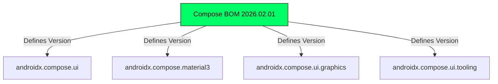
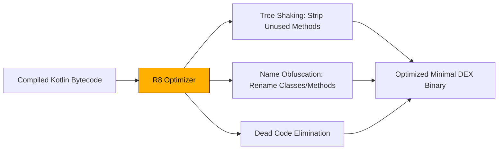

# 📖 Chapter 2: Modern Android Build System & Version Catalogs

---

## 🎯 Chapter Overview & Learning Objectives

Welcome to **Chapter 2** of *The Art of Android Shells: Building Terminal Launcher from Scratch*.

In this chapter, you will master the modern Android build system powered by **Gradle Kotlin DSL (`.gradle.kts`)**, **Gradle Version Catalogs (`libs.versions.toml`)**, and **Jetpack Compose Bill of Materials (BOM)**. Understanding build management is essential for maintaining clean dependencies, optimizing compile times, enforcing target SDK compliance, and producing lightweight, production-ready APK binaries.

By the end of this chapter, you will understand:
1. The three-tier structure of Gradle configuration files ([settings.gradle.kts](file:///home/mohammed/StudioProjects/Terminal-Launcher/settings.gradle.kts), root [build.gradle.kts](file:///home/mohammed/StudioProjects/Terminal-Launcher/build.gradle.kts), and module [app/build.gradle.kts](file:///home/mohammed/StudioProjects/Terminal-Launcher/app/build.gradle.kts)).
2. How to manage dependencies centrally using Gradle Version Catalogs ([gradle/libs.versions.toml](file:///home/mohammed/StudioProjects/Terminal-Launcher/gradle/libs.versions.toml)) and the Compose BOM.
3. The architectural significance of Target SDK 37, Min SDK 26, and AGP 9.4.1 R8 code optimization.
4. Semantic versioning strategy (`versionCode` vs `versionName`) for Google Play Store deployments.

---

## 2.1 Anatomy of Gradle KTS (Kotlin DSL)

Modern Android development has migrated from legacy Groovy scripts (`.gradle`) to type-safe **Kotlin DSL (`.gradle.kts`)**. Kotlin DSL provides compile-time auto-completion, refactoring support, and instant script error checking right inside Android Studio.

Terminal Launcher uses a modular three-tier Gradle script architecture:

```text
Terminal-Launcher/
├── settings.gradle.kts           # Global Repository & Module Management
├── build.gradle.kts              # Root Project Configuration & Plugin Declarations
├── app/
│   └── build.gradle.kts          # App Module Build & Android Plugin Settings
└── gradle/
    └── libs.versions.toml        # Central Version Catalog
```

### 1. Global Module & Repository Resolution ([settings.gradle.kts](file:///home/mohammed/StudioProjects/Terminal-Launcher/settings.gradle.kts))

[settings.gradle.kts](file:///home/mohammed/StudioProjects/Terminal-Launcher/settings.gradle.kts) initializes the build graph, defines software repositories, and includes sub-modules:

```kotlin
pluginManagement {
    repositories {
        google {
            content {
                includeGroupByRegex("com\\.android.*")
                includeGroupByRegex("com\\.google.*")
                includeGroupByRegex("androidx.*")
            }
        }
        mavenCentral()
        gradlePluginPortal()
    }
}

dependencyResolutionManagement {
    repositoriesMode.set(RepositoriesMode.FAIL_ON_PROJECT_REPOS)
    repositories {
        google()
        mavenCentral()
    }
}

rootProject.name = "Terminal Launcher"
include(":app")
```

#### Key Architecture Concepts in `settings.gradle.kts`:
* **`RepositoriesMode.FAIL_ON_PROJECT_REPOS`**: Enforces central repository definition. If an individual module (`:app`) tries to define its own repositories, the build fails immediately. This prevents rogue third-party dependencies from being injected into individual modules.
* **`pluginManagement.google.content` regex filter**: Optimizes build performance by restricting Gradle's network search—telling Gradle to fetch `androidx.*` and `com.android.*` strictly from Google's Maven repository rather than querying `mavenCentral()` unnecessarily.

---

### 2. Root Project Build File ([build.gradle.kts](file:///home/mohammed/StudioProjects/Terminal-Launcher/build.gradle.kts))

The root [build.gradle.kts](file:///home/mohammed/StudioProjects/Terminal-Launcher/build.gradle.kts) declares top-level plugins with `apply false`:

```kotlin
// Top-level build file where you can add configuration options common to all sub-projects/modules.
plugins {
    alias(libs.plugins.android.application) apply false
    alias(libs.plugins.kotlin.compose) apply false
}
```

By applying plugins with `apply false` at the root level, Gradle pre-downloads and loads the Android Application plugin and Kotlin Compose compiler plugin into the build classpath without executing them in the root context. Sub-modules can then apply them on demand without version duplication.

---

### 3. Module Build Script ([app/build.gradle.kts](file:///home/mohammed/StudioProjects/Terminal-Launcher/app/build.gradle.kts))

The `:app` module script defines application IDs, SDK targets, build types, and project dependencies:

```kotlin
plugins {
    alias(libs.plugins.android.application)
    alias(libs.plugins.kotlin.compose)
}

android {
    namespace = "com.example.terminallauncher"
    compileSdk {
        version = release(37)
    }

    defaultConfig {
        applicationId = "com.example.terminallauncher"
        minSdk = 26
        targetSdk = 37
        versionCode = 2
        versionName = "1.1.0"

        testInstrumentationRunner = "androidx.test.runner.AndroidJUnitRunner"
    }
    // ...
}
```

---

## 2.2 Version Catalogs & BOM Management

Managing dependencies across Android projects historically suffered from "dependency hell"—where mismatched versions of Compose libraries caused runtime crashes. Modern Gradle solves this using **Version Catalogs (`libs.versions.toml`)** and **Bill of Materials (BOM)**.

### The Version Catalog ([gradle/libs.versions.toml](file:///home/mohammed/StudioProjects/Terminal-Launcher/gradle/libs.versions.toml))

The `.toml` (Tom's Obvious Minimal Language) file provides a single source of truth for all project versions:

```toml
[versions]
agp = "9.4.1"
coreKtx = "1.19.1"
junit = "4.13.2"
junitVersion = "1.3.0"
espressoCore = "3.7.0"
lifecycleRuntimeKtx = "2.11.0"
activityCompose = "1.13.0"
kotlin = "2.2.10"
composeBom = "2026.02.01"
dataStore = "1.1.3"

[libraries]
androidx-core-ktx = { group = "androidx.core", name = "core-ktx", version.ref = "coreKtx" }
androidx-lifecycle-runtime-ktx = { group = "androidx.lifecycle", name = "lifecycle-runtime-ktx", version.ref = "lifecycleRuntimeKtx" }
androidx-datastore-preferences = { group = "androidx.datastore", name = "datastore-preferences", version.ref = "dataStore" }
androidx-activity-compose = { group = "androidx.activity", name = "activity-compose", version.ref = "activityCompose" }

# Compose BOM platform
androidx-compose-bom = { group = "androidx.compose", name = "compose-bom", version.ref = "composeBom" }
androidx-compose-ui = { group = "androidx.compose.ui", name = "ui" }
androidx-compose-material3 = { group = "androidx.compose.material3", name = "material3" }

[plugins]
android-application = { id = "com.android.application", version.ref = "agp" }
kotlin-compose = { id = "org.jetbrains.kotlin.plugin.compose", version.ref = "kotlin" }
```

### Type-Safe Accessors in Kotlin DSL

Gradle automatically converts hyphenated TOML keys into type-safe dot-notation accessors in Kotlin DSL:

* `androidx-core-ktx` $\rightarrow$ `libs.androidx.core.ktx`
* `androidx-compose-material3` $\rightarrow$ `libs.androidx.compose.material3`

---

### Jetpack Compose Bill of Materials (BOM)

In [app/build.gradle.kts](file:///home/mohammed/StudioProjects/Terminal-Launcher/app/build.gradle.kts#L41-L47), Compose dependencies are declared using the Compose BOM:

```kotlin
dependencies {
    // Import the Compose BOM
    implementation(platform(libs.androidx.compose.bom))

    // Notice no version numbers are specified below!
    implementation(libs.androidx.compose.ui)
    implementation(libs.androidx.compose.ui.graphics)
    implementation(libs.androidx.compose.material3)
    implementation(libs.androidx.compose.ui.tooling.preview)
    implementation(libs.androidx.datastore.preferences)
}
```



#### Why Use a BOM?
Without a BOM, developer teams must manually align individual versions of `compose.ui`, `material3`, and `ui-tooling`. If `material3` requires a newer internal Compose UI foundation than `compose.ui`, the app crashes at runtime. The BOM acts as a synchronized release platform: declaring `implementation(platform(libs.androidx.compose.bom))` forces all Compose libraries to use tested, fully compatible version matrices!

---

## 2.3 SDK Targets & R8 Code Optimization

The Android block in [app/build.gradle.kts](file:///home/mohammed/StudioProjects/Terminal-Launcher/app/build.gradle.kts#L6-L30) specifies SDK target compatibility and release optimization:

```kotlin
android {
    namespace = "com.example.terminallauncher"
    compileSdk {
        version = release(37)
    }

    defaultConfig {
        applicationId = "com.example.terminallauncher"
        minSdk = 26
        targetSdk = 37
        versionCode = 2
        versionName = "1.1.0"
    }

    buildTypes {
        release {
            optimization {
                enable = true
                packageScope = setOf("androidx.**", "kotlin.**", "kotlinx.**")
            }
        }
    }
}
```

### SDK Target Breakdown:

1. **`minSdk = 26` (Android 8.0 Oreo)**:
   * Provides baseline support for ~99% of active Android devices worldwide.
   * Guarantees native OS support for Notification Channels, Adaptive Launcher Icons, Core Library Desugaring (Java 8+ APIs), and Jetpack DataStore file I/O operations.
2. **`targetSdk = 37` & `compileSdk = 37`**:
   * Ensures Terminal Launcher compiles against the latest Android APIs and runtime behaviors (e.g. forced Edge-to-Edge display, updated predictive back gesture callbacks, and modern permission models).

---

### R8 ProGuard Code Optimization in AGP 9.4.1+

When building a release APK (`./gradlew app:assembleRelease`), Android Gradle Plugin uses **R8** (Android's next-generation code shrinker and optimizer):

```kotlin
buildTypes {
    release {
        optimization {
            enable = true
            packageScope = setOf("androidx.**", "kotlin.**", "kotlinx.**")
        }
    }
}
```



#### R8's 3 Pillars of Binary Shrinking:
1. **Tree Shaking**: Analyzes entry points (`MainActivity`) and walks the invocation tree. Any library class or function never called in code is stripped from the DEX file.
2. **Dead-Code Elimination**: Removes unused conditional branches, unused loggers, and debug instructions.
3. **Name Obfuscation**: Renames long package names and internal methods to short identifiers (`a`, `b`, `c`), reducing file size and protecting against reverse-engineering.

---

## 2.4 Version Numbering & Play Store Release Policy

Android enforces two distinct version identifiers inside [app/build.gradle.kts](file:///home/mohammed/StudioProjects/Terminal-Launcher/app/build.gradle.kts#L13-L14):

```kotlin
versionCode = 2
versionName = "1.1.0"
```

### `versionCode` vs `versionName`

| Identifier | Format | Audience | Purpose |
| :--- | :--- | :--- | :--- |
| **`versionCode`** | Positive Integer (`1, 2, 3...`) | Android OS & Google Play Store | A monotonically increasing integer. Google Play requires every new APK upload to have a strictly higher `versionCode` than the previous build to trigger app updates on user devices. |
| **`versionName`** | String (`"1.1.0"`) | Human Users | Displayed in `about` command output and app settings (`v1.1.0`). Follows Semantic Versioning. |

### Semantic Versioning (SemVer) Strategy (`vMAJOR.MINOR.PATCH`):

Terminal Launcher adopts standard Semantic Versioning (`v1.1.0`):

* **MAJOR (1.x.x)**: Incremented on major UI redesigns or breaking architecture overhauls (e.g. migrating from View system to Jetpack Compose).
* **MINOR (x.1.x)**: Incremented when new shell commands, themes, ASCII banners, or hardware integrations are added (e.g. adding `infofetch`, 8-bit audio synthesizer, or Termux integration).
* **PATCH (x.x.1)**: Incremented for hotfixes, memory leak resolutions, or minor bug fixes.

---

## 📝 Summary & Key Takeaways

1. **Gradle KTS**: Provides a type-safe Kotlin environment across `settings.gradle.kts`, root `build.gradle.kts`, and `app/build.gradle.kts`.
2. **Version Catalogs**: `gradle/libs.versions.toml` centralizes version numbers and plugins, eliminating dependency fragmentation.
3. **Compose BOM**: Standardizes version matrices across all Compose UI artifacts without manual version management.
4. **Build Optimization**: Target SDK 37 keeps the app compliant with modern Android OS runtime policies, while AGP 9.4.1 R8 optimization strips unused bytecode to keep the launcher APK lightweight.

---

## ❓ Chapter 2 Self-Assessment Exercises

1. Why does `settings.gradle.kts` configure `RepositoriesMode.FAIL_ON_PROJECT_REPOS`?
   * *Answer*: To prevent individual sub-modules from defining custom repositories, ensuring all dependencies originate strictly from approved central repositories like Google Maven and Maven Central.
2. What happens if you add a new Compose library without specifying a version while using the Compose BOM?
   * *Answer*: Gradle automatically resolves the version to match the BOM version manifest defined in `libs.versions.toml`.
3. What is the difference between `versionCode` and `versionName`?
   * *Answer*: `versionCode` is an internal integer used by Google Play and the Android OS to check for updates, whereas `versionName` is a user-facing semantic version string (e.g., `"1.1.0"`).

---

👉 **Next Step**: Proceed to [Chapter 3: Architecture Patterns & The MVVM Paradigm](file:///home/mohammed/StudioProjects/Terminal-Launcher/docs/CHAPTER_3.md) to explore Unidirectional Data Flow (UDF), ViewModels, and state persistence!
