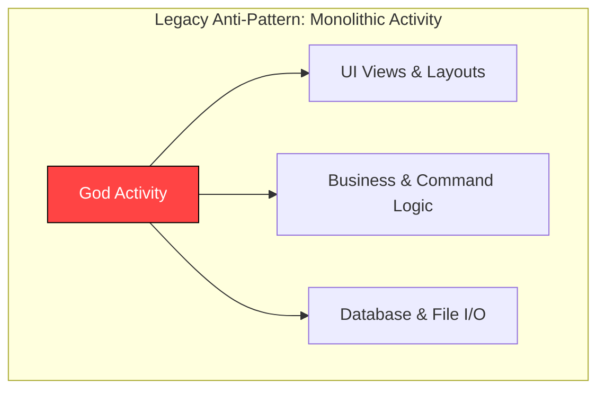
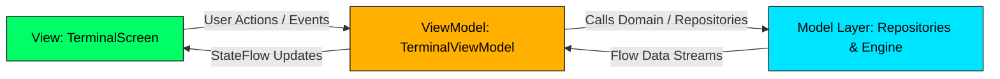
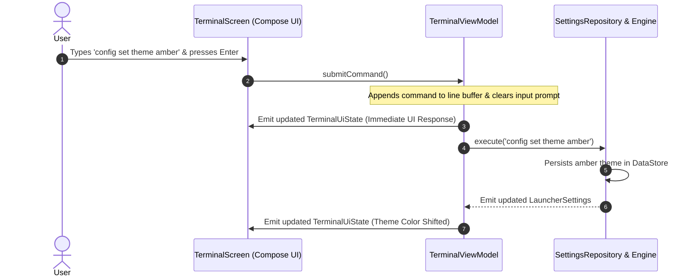

# 📖 Chapter 3: Architecture Patterns & The MVVM Paradigm

---

## 🎯 Chapter Overview & Learning Objectives

Welcome to **Chapter 3** of *The Art of Android Shells: Building Terminal Launcher from Scratch*.

In this chapter, you will learn how to structure a production-grade, reactive Android application using **Model-View-ViewModel (MVVM)** architecture, **Unidirectional Data Flow (UDF)**, and **Clean Architecture Separation of Concerns**. As applications grow in complexity, mixing UI rendering with business logic leads to unmaintainable, bug-ridden code. By decoupling components into clear architectural layers, Terminal Launcher achieves high performance, predictable state management, and effortless unit testing.

By the end of this chapter, you will understand:
1. Why modern Android development mandates MVVM over legacy "God Activity" monoliths.
2. How Unidirectional Data Flow (UDF) operates using `StateFlow`, `collectAsState()`, and immutable data classes.
3. The distinct responsibilities of the View, ViewModel, Repositories, and Command Engine layers in Terminal Launcher.

---

## 3.1 Why Model-View-ViewModel (MVVM)?

In early Android development, developers placed UI drawing, network requests, database access, and event handling directly inside `Activity` classes. These were known as **"God Activities"**—massive 3,000-line files that crashed whenever the device rotated or experienced low memory pressure.



### The MVVM Solution:

**Model-View-ViewModel (MVVM)** divides application responsibilities into three distinct roles:



1. **View**: Pure, declarative UI components ([TerminalScreen.kt](file:///home/mohammed/StudioProjects/Terminal-Launcher/app/src/main/java/com/example/terminallauncher/ui/TerminalScreen.kt)). Renders whatever state it receives from the ViewModel and delegates user interactions (key taps, text changes) directly to the ViewModel.
2. **ViewModel**: The UI state manager ([TerminalViewModel.kt](file:///home/mohammed/StudioProjects/Terminal-Launcher/app/src/main/java/com/example/terminallauncher/ui/TerminalViewModel.kt)). Survives configuration changes (screen rotations, multi-window splits) without destroying in-memory UI state or re-executing ongoing coroutines.
3. **Model**: The data and domain layer ([SettingsRepository.kt](file:///home/mohammed/StudioProjects/Terminal-Launcher/app/src/main/java/com/example/terminallauncher/data/SettingsRepository.kt), [AppRepository.kt](file:///home/mohammed/StudioProjects/Terminal-Launcher/app/src/main/java/com/example/terminallauncher/data/AppRepository.kt), and [CommandEngine.kt](file:///home/mohammed/StudioProjects/Terminal-Launcher/app/src/main/java/com/example/terminallauncher/data/CommandEngine.kt)). Manages persistent storage, system app querying, and command execution algorithms.

---

## 3.2 Unidirectional Data Flow (UDF) in Reactive Android

Terminal Launcher adopts **Unidirectional Data Flow (UDF)** to manage terminal state predictably. In UDF, data flows in **one direction**:

* **State** flows **DOWN** from the ViewModel to the Compose UI View via `StateFlow`.
* **Events** flow **UP** from the Compose UI View to the ViewModel via function callbacks.



### Immutable UI State Representation

Terminal Launcher defines its entire UI state inside a single, immutable Kotlin data class in [TerminalViewModel.kt](file:///home/mohammed/StudioProjects/Terminal-Launcher/app/src/main/java/com/example/terminallauncher/ui/TerminalViewModel.kt#L21-L30):

```kotlin
data class TerminalUiState(
    val lines: List<TerminalLine> = emptyList(),
    val inputFieldValue: TextFieldValue = TextFieldValue(""),
    val ghostSuffix: String = "",
    val settings: LauncherSettings = LauncherSettings(),
    val historyIndex: Int = -1,
    val isFirstRunPromptActive: Boolean = false,
    val isOptionsMenuVisible: Boolean = false,
    val isMatrixActive: Boolean = false
)
```

#### Why Immutability Matters in Jetpack Compose:
1. **Thread Safety**: Immutable objects cannot be modified concurrently by multiple threads, eliminating race conditions when background coroutines update terminal state.
2. **Recomposition Optimization**: Jetpack Compose checks object references. When `_uiState.value` is updated using `.copy()`, Compose skips re-rendering composables whose individual state inputs have not changed!

---

## 3.3 Separation of Concerns: The 4 Core Layers

Terminal Launcher breaks down its architecture into 4 isolated layers:

```mermaid
graph TD
    subgraph 1. View Layer (Jetpack Compose UI)
        TS[TerminalScreen.kt]
        OM[OptionsMenuDialog.kt]
        MR[MatrixRainScreen.kt]
    end

    subgraph 2. ViewModel Layer (State Holder)
        VM[TerminalViewModel.kt]
    end

    subgraph 3. Domain Layer (Command Execution Engine)
        CE[CommandEngine.kt]
    end

    subgraph 4. Data Layer (Repositories & Persistence)
        AR[AppRepository.kt]
        SR[SettingsRepository.kt]
        DS[(DataStore Preferences)]
        PM[(Android PackageManager)]
    end

    TS -->|Collects StateFlow| VM
    OM -->|Triggers Callbacks| VM
    VM -->|Executes Commands| CE
    CE -->|Queries Apps| AR
    CE -->|Reads/Writes Config| SR
    VM -->|Subscribes to Flows| SR
    AR -->|Queries| PM
    SR -->|Persists| DS

    style TS fill:#00FF66,stroke:#0A0D0A,color:#000
    style VM fill:#FFB000,stroke:#0D0B08,color:#000
    style CE fill:#FF5555,stroke:#000,color:#FFF
    style AR fill:#00E5FF,stroke:#0A0D0A,color:#000
    style SR fill:#00E5FF,stroke:#0A0D0A,color:#000
```

---

### Layer 1: The UI View Layer ([TerminalScreen.kt](file:///home/mohammed/StudioProjects/Terminal-Launcher/app/src/main/java/com/example/terminallauncher/ui/TerminalScreen.kt))

The UI layer is written entirely in declarative Jetpack Compose. It collects state using `collectAsState()` and contains **zero business or storage logic**:

```kotlin
@Composable
fun TerminalScreen(
    viewModel: TerminalViewModel = viewModel()
) {
    // Collect reactive UI state from ViewModel
    val uiState by viewModel.uiState.collectAsState()
    val colorScheme = remember(uiState.settings.theme) { 
        getTerminalColorScheme(uiState.settings.theme) 
    }
    
    // ... Render UI elements based strictly on uiState
}
```

---

### Layer 2: The ViewModel State Holder ([TerminalViewModel.kt](file:///home/mohammed/StudioProjects/Terminal-Launcher/app/src/main/java/com/example/terminallauncher/ui/TerminalViewModel.kt))

The ViewModel inherits from `AndroidViewModel(application)`. It exposes a read-only `StateFlow<TerminalUiState>` while maintaining a private mutable state flow `_uiState`:

```kotlin
class TerminalViewModel(application: Application) : AndroidViewModel(application) {

    private val appRepository = AppRepository(application)
    private val settingsRepository = SettingsRepository(application)
    private val commandEngine = CommandEngine(application, appRepository, settingsRepository)

    // Private backing state flow for internal mutations
    private val _uiState = MutableStateFlow(TerminalUiState())
    
    // Public immutable state flow exposed to Compose UI
    val uiState: StateFlow<TerminalUiState> = _uiState.asStateFlow()

    fun submitCommand() {
        val currentText = _uiState.value.inputFieldValue.text
        val ghostSuffix = _uiState.value.ghostSuffix
        val input = if (ghostSuffix.isNotEmpty()) currentText + ghostSuffix else currentText

        // Emit updated line buffer immediately to UI
        val updatedLines = _uiState.value.lines.toMutableList().apply {
            add(TerminalLine(text = "${_uiState.value.settings.promptString}$input", type = LineType.INPUT))
        }
        _uiState.value = _uiState.value.copy(
            inputFieldValue = TextFieldValue(""),
            ghostSuffix = "",
            lines = updatedLines
        )

        // Execute command asynchronously in viewModelScope
        viewModelScope.launch {
            val result = commandEngine.execute(input, _uiState.value.settings)
            // Handle command result output...
        }
    }
}
```

---

### Layer 3: The Domain Layer ([CommandEngine.kt](file:///home/mohammed/StudioProjects/Terminal-Launcher/app/src/main/java/com/example/terminallauncher/data/CommandEngine.kt))

`CommandEngine` acts as the domain interpreter. It is decoupled from Android UI code—taking input command strings, parsing arguments, calling repositories, and returning structured `CommandResult` objects:

```kotlin
data class CommandResult(
    val outputLines: List<TerminalLine> = emptyList(),
    val shouldClearBuffer: Boolean = false,
    val openOptionsMenu: Boolean = false,
    val openMatrixMode: Boolean = false
)
```

---

### Layer 4: The Data Layer ([SettingsRepository.kt](file:///home/mohammed/StudioProjects/Terminal-Launcher/app/src/main/java/com/example/terminallauncher/data/SettingsRepository.kt) & [AppRepository.kt](file:///home/mohammed/StudioProjects/Terminal-Launcher/app/src/main/java/com/example/terminallauncher/data/AppRepository.kt))

The data layer handles data access:
* **[AppRepository.kt](file:///home/mohammed/StudioProjects/Terminal-Launcher/app/src/main/java/com/example/terminallauncher/data/AppRepository.kt)**: Queries `PackageManager` for installed launcher applications, handles duplicate app disambiguation, and manages launch intents.
* **[SettingsRepository.kt](file:///home/mohammed/StudioProjects/Terminal-Launcher/app/src/main/java/com/example/terminallauncher/data/SettingsRepository.kt)**: Manages asynchronous, non-blocking persistence using Jetpack DataStore Preferences, exposing reactive streams like `Flow<LauncherSettings>` and `Flow<List<TerminalLine>>`.

---

## 📝 Summary & Key Takeaways

1. **MVVM Pattern**: Decouples UI composables ([TerminalScreen.kt](file:///home/mohammed/StudioProjects/Terminal-Launcher/app/src/main/java/com/example/terminallauncher/ui/TerminalScreen.kt)) from state management ([TerminalViewModel.kt](file:///home/mohammed/StudioProjects/Terminal-Launcher/app/src/main/java/com/example/terminallauncher/ui/TerminalViewModel.kt)) and persistence ([SettingsRepository.kt](file:///home/mohammed/StudioProjects/Terminal-Launcher/app/src/main/java/com/example/terminallauncher/data/SettingsRepository.kt)).
2. **Unidirectional Data Flow (UDF)**: State flows DOWN from ViewModel to Compose UI via `StateFlow`; events flow UP from Compose UI to ViewModel via function calls.
3. **Immutability**: `TerminalUiState` is an immutable data class updated via `.copy()`, ensuring thread safety and efficient Jetpack Compose recomposition skips.
4. **Clean Architecture**: `CommandEngine` acts as an isolated domain interpreter, transforming raw text strings into `CommandResult` payloads.

---

## ❓ Chapter 3 Self-Assessment Exercises

1. What is the benefit of inheriting from `AndroidViewModel` instead of standard `ViewModel` in [TerminalViewModel.kt](file:///home/mohammed/StudioProjects/Terminal-Launcher/app/src/main/java/com/example/terminallauncher/ui/TerminalViewModel.kt#L32)?
   * *Answer*: `AndroidViewModel` provides a safe reference to the application `Context`, which is required to query system services (`PackageManager`) and open Jetpack DataStore files without leaking `Activity` contexts.
2. What happens if a background thread attempts to modify `TerminalUiState` directly without creating a new copy via `.copy()`?
   * *Answer*: In Kotlin, data class properties in `TerminalUiState` are declared with `val` (read-only), preventing direct mutation and ensuring strict compile-time state safety.
3. Why does `TerminalViewModel` expose `val uiState: StateFlow<TerminalUiState>` instead of `MutableStateFlow` to composables?
   * *Answer*: Exposing read-only `StateFlow` enforces UDF by preventing UI composables from directly modifying state—forcing all state changes to pass through validated ViewModel functions.

---

👉 **Next Step**: Proceed to [Chapter 4: Querying System Applications & Disambiguation Algorithms](file:///home/mohammed/StudioProjects/Terminal-Launcher/docs/CHAPTER_4.md) to explore `PackageManager` querying, zero-icon memory optimization, and auto-disambiguation!
