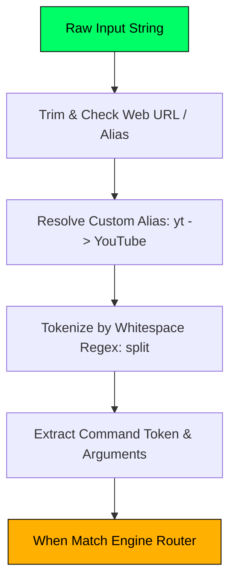

# 📖 Chapter 6: The Command Interpreter & Engine Operations

---

## 🎯 Chapter Overview & Learning Objectives

Welcome to **Chapter 6** of *The Art of Android Shells: Building Terminal Launcher from Scratch*.

In this chapter, you will explore the heart of Terminal Launcher: the **Command Engine ([CommandEngine.kt](file:///home/mohammed/StudioProjects/Terminal-Launcher/app/src/main/java/com/example/terminallauncher/data/CommandEngine.kt))**. `CommandEngine` parses string inputs from the prompt, tokenizes arguments, expands shell environment variables (`$USER`, `$PROMPT`), traverses file storage (`ls`, `cd`, `cat`), and dispatches native Android Intents for calls, emails, web searches, Play Store installs, hardware toggles, real-time 8-bit PCM audio synthesis, and Linux Termux execution.

By the end of this chapter, you will understand:
1. Command tokenization, alias resolution, and `$VAR` string expansion.
2. File system and external storage traversal (`ls /storage`, `cd`, `cat/read`).
3. Hardware toggles (`sys flash`, `sys ringer`) and native intent dispatching.
4. Real-time 8-bit square-wave PCM audio synthesis using Android's low-level `AudioTrack` API.
5. Termux background command service dispatching (`com.termux.RUN_COMMAND`).

---

## 6.1 Command Tokenization & Alias Resolution

When a user submits a string (e.g. `yt` or `echo "Hello $USER"`), [CommandEngine.kt](file:///home/mohammed/StudioProjects/Terminal-Launcher/app/src/main/java/com/example/terminallauncher/data/CommandEngine.kt#L52-L96) processes the input in three steps:



### 1. Alias Resolution:
Before tokenization, `CommandEngine` checks `currentSettings.aliases`:

```kotlin
val resolvedCommand = currentSettings.aliases[trimmed.lowercase()] ?: trimmed
val tokens = resolvedCommand.split(Regex("\\s+"))
val cmd = tokens.first().lowercase()
val args = tokens.drop(1)
```

If the user typed `yt`, the engine resolves `yt` $\rightarrow$ `YouTube`.

### 2. Variable Expansion in `echo`:

The `handleEcho` function expands shell environment variables dynamically:

```kotlin
val userStr = settings.promptString.split("@").firstOrNull() ?: "user"
val expandedText = text
    .replace("\$USER", userStr)
    .replace("\$PROMPT", settings.promptString)
    .replace("\$THEME", settings.theme.name.lowercase())
    .replace("\$VERSION", "v1.1.0")
    .replace("\$OS", "Android ${Build.VERSION.RELEASE}")
```

* Command: `echo "Operating System: $OS"` $\rightarrow$ Output: `Operating System: Android 15`

---

## 6.2 File System Storage Traversal (`ls`, `cd`, `cat`)

Terminal Launcher allows developers and power users to navigate device storage directly inside the terminal interface.

```kotlin
private fun handleCat(filePath: String): CommandResult {
    if (filePath.isBlank()) {
        return CommandResult(
            outputLines = listOf(TerminalLine(text = "Usage: cat <file_path>", type = LineType.ERROR)),
            success = false
        )
    }

    val targetFile = resolveStoragePath(filePath)
    if (!targetFile.exists()) {
        return CommandResult(
            outputLines = listOf(TerminalLine(text = "cat: file not found: '$filePath'", type = LineType.ERROR)),
            success = false
        )
    }

    return try {
        val allLines = targetFile.readLines(Charsets.UTF_8)
        val linesToDisplay = allLines.take(100) // Buffer limit
        val output = mutableListOf<TerminalLine>()
        output.add(TerminalLine(text = "=== CONTENT: ${targetFile.name} ===", type = LineType.HEADER))
        linesToDisplay.forEach { output.add(TerminalLine(text = it, type = LineType.OUTPUT)) }
        CommandResult(outputLines = output)
    } catch (e: Exception) {
        CommandResult(outputLines = listOf(TerminalLine(text = "Error reading file: ${e.message}", type = LineType.ERROR)))
    }
}
```

* `ls /storage`: Displays available storage mounts (`storage0` $\rightarrow$ primary internal storage; `storage1` $\rightarrow$ external SD card).
* `cd storage0/Download`: Changes active directory path state.
* `cat /read notes.txt`: Displays file text lines inside the terminal scroll buffer.

---

## 6.3 Real-Time 8-Bit PCM Chiptune Audio Synthesis (`AudioTrack`)

To demonstrate real-time hardware interaction without external MP3/WAV assets, `handle8BitTune()` in [CommandEngine.kt](file:///home/mohammed/StudioProjects/Terminal-Launcher/app/src/main/java/com/example/terminallauncher/data/CommandEngine.kt#L190-L260) synthesizes a retro square-wave audio chiptune in memory using Android's native `AudioTrack` API.

### Square Wave Synthesis Physics:

A square wave generates classic 8-bit NES/GameBoy audio. At a sample rate of $22,050 \text{ Hz}$, a tone of frequency $f$ has a wave period $P = \frac{\text{SampleRate}}{f}$. The PCM sample value toggles between $+8000$ and $-8000$:

$$\text{Sample}[i] = \begin{cases} +8000 & \text{if } (i \bmod P) < \frac{P}{2} \\ -8000 & \text{otherwise} \end{cases}$$

```kotlin
val sampleRate = 22050
val melody = listOf(
    261.63 to 150, // C4
    329.63 to 150, // E4
    392.00 to 150, // G4
    523.25 to 300  // C5
)

val audioTrack = AudioTrack.Builder()
    .setAudioAttributes(AudioAttributes.Builder().setUsage(AudioAttributes.USAGE_GAME).build())
    .setAudioFormat(AudioFormat.Builder().setSampleRate(sampleRate).setEncoding(AudioFormat.ENCODING_PCM_16BIT).setChannelMask(AudioFormat.CHANNEL_OUT_MONO).build())
    .setBufferSizeInBytes(4096)
    .setTransferMode(AudioTrack.MODE_STREAM)
    .build()

audioTrack.play()

// Synthesize PCM samples on background thread
Thread {
    for ((freq, durationMs) in melody) {
        val numSamples = (sampleRate * (durationMs / 1000.0)).toInt()
        val sample = ShortArray(numSamples)
        val period = sampleRate / freq
        for (i in 0 until numSamples) {
            sample[i] = if ((i % period) < (period / 2)) 8000 else -8000
        }
        audioTrack.write(sample, 0, sample.size)
    }
    audioTrack.stop()
    audioTrack.release()
}.start()
```

This 8-bit synthesizer produces retro audio with **0 MB storage footprint** and **0 external audio asset files**!

---

## 6.4 Termux Integration (`com.termux.RUN_COMMAND`)

Terminal Launcher integrates natively with the **Termux Linux environment**. Power users can execute shell scripts, Python scripts, or package managers directly from Terminal Launcher using the `tx <command>` or `termux <command>` shortcut.

```kotlin
val intent = Intent("com.termux.RUN_COMMAND").apply {
    setClassName("com.termux", "com.termux.app.RunCommandService")
    putExtra("com.termux.RUN_COMMAND_PATH", "/data/data/com.termux/files/usr/bin/bash")
    putExtra("com.termux.RUN_COMMAND_ARGUMENTS", arrayOf("-c", fullCommand))
    putExtra("com.termux.RUN_COMMAND_WORKDIR", "/data/data/com.termux/files/home")
    putExtra("com.termux.RUN_COMMAND_BACKGROUND", !isInteractive)
    addFlags(Intent.FLAG_ACTIVITY_NEW_TASK)
}
context.startService(intent)
```

* Background execution: Command `tx pkg update` runs silently in Termux's background service.
* Interactive execution: Commands like `tx htop`, `tx vim`, or `tx python` automatically open Termux in foreground session mode.

---

## 📝 Summary & Key Takeaways

1. **Tokenization & Routing**: `CommandEngine` tokenizes inputs, resolves custom user aliases, and replaces shell variables (`$USER`, `$PROMPT`, `$OS`).
2. **Storage Traversal**: Built-in `ls`, `cd`, and `cat` commands allow file browsing and reading directly inside the terminal viewport.
3. **8-Bit Synthesis**: Synthesizes square-wave PCM audio directly to `AudioTrack` with zero external media files.
4. **Termux Service**: Inter-process communication (IPC) via `com.termux.RUN_COMMAND` enables execution of full Linux commands.

---

## ❓ Chapter 6 Self-Assessment Exercises

1. How does `CommandEngine` determine whether an input is a URL (e.g. `github.com`) versus a shell command?
   * *Answer*: `isWebUrl()` checks for URL schemes (`https://`) or common domain extensions (`.com`, `.org`, `.net`, `.io`), dispatching a web browser intent if matched.
2. Why is square wave synthesis preferred over sine wave synthesis for retro 8-bit audio?
   * *Answer*: Square waves produce odd harmonics that replicate classic 1980s 8-bit sound chips (N2A03 in NES, GameBoy APU) and require simple integer comparison logic (`i % period < period / 2`).

---

👉 **Next Step**: Proceed to [Chapter 7: Reactive UI & High-Performance Rendering with Jetpack Compose](file:///home/mohammed/StudioProjects/Terminal-Launcher/docs/CHAPTER_7.md) to learn about Compose layouts, IME insets, and key event handling!
