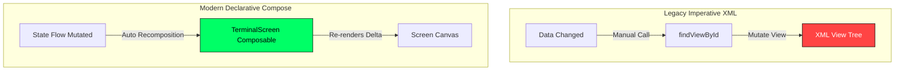
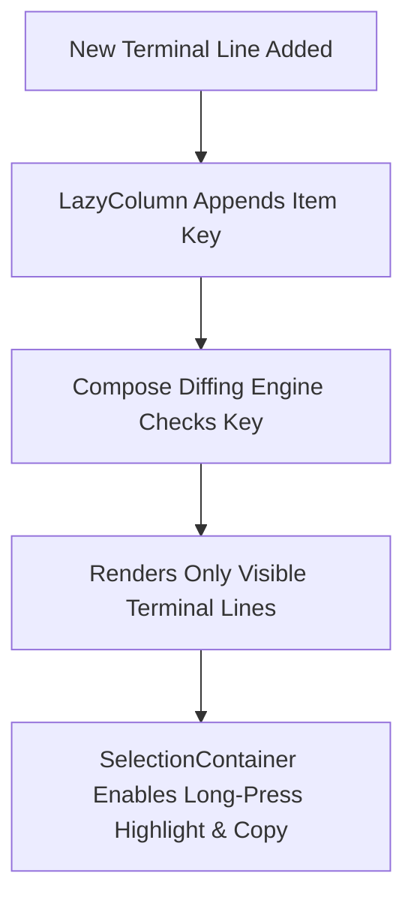

# 📖 Chapter 7: Reactive UI & High-Performance Rendering with Jetpack Compose

---

## 🎯 Chapter Overview & Learning Objectives

Welcome to **Chapter 7** of *The Art of Android Shells: Building Terminal Launcher from Scratch*.

In this chapter, you will master high-performance UI rendering using **Jetpack Compose**. Unlike legacy XML layouts that suffer from deep view hierarchy inflation, Compose uses declarative Kotlin functions to draw reactive, 120Hz-accelerated interfaces. You will learn how Terminal Launcher handles edge-to-edge window insets (`imePadding()`), hardware keyboard event interception (`onPreviewKeyEvent`), text output selection/copy-paste, overlay dialogs, and Matrix Digital Rain animations.

By the end of this chapter, you will understand:
1. Why declarative Compose beats imperative XML layout inflation.
2. How to manage edge-to-edge system bar insets (`statusBarsPadding()`, `navigationBarsPadding()`, `imePadding()`).
3. How `LazyColumn` and `SelectionContainer` enable text highlighting and copying across the terminal buffer.
4. Hardware keyboard event interception (`onPreviewKeyEvent` for Tab, Backspace, Arrows, Ctrl+C, Ctrl+V).
5. Overlay dialogs ([OptionsMenuDialog.kt](file:///home/mohammed/StudioProjects/Terminal-Launcher/app/src/main/java/com/example/terminallauncher/ui/OptionsMenuDialog.kt)) and Matrix Rain Canvas rendering ([MatrixRainScreen.kt](file:///home/mohammed/StudioProjects/Terminal-Launcher/app/src/main/java/com/example/terminallauncher/ui/MatrixRainScreen.kt)).

---

## 7.1 Declarative Compose vs Imperative XML Views

In legacy Android View development (`res/layout/activity_main.xml`), updating a view required imperative DOM-like calls (`findViewById()`, `setText()`, `setVisibility()`). This created state synchronization bugs when views failed to reflect underlying data models.



Jetpack Compose transforms data directly into UI: `UI = f(State)`. When `uiState` changes, Compose automatically re-executes affected composable functions while skipping unchanged nodes.

---

## 7.2 Edge-to-Edge Bar Insets & Layout Padding

Terminal Launcher extends edge-to-edge behind the Android status bar and navigation bar. To prevent system bars or the virtual keyboard from obscuring the terminal output or active prompt line, [TerminalScreen.kt](file:///home/mohammed/StudioProjects/Terminal-Launcher/app/src/main/java/com/example/terminallauncher/ui/TerminalScreen.kt#L125-L135) applies window insets:

```kotlin
Box(
    modifier = Modifier
        .fillMaxSize()
        .background(colorScheme.background)
        .statusBarsPadding()      // Pushes content below status bar
        .navigationBarsPadding()  // Pushes content above navigation bar
        .imePadding()             // Dynamically resizes layout when soft keyboard opens
        .padding(start = 12.dp, end = 12.dp, top = 12.dp, bottom = 20.dp)
)
```

`imePadding()` dynamically shrinks the `LazyColumn` height when the IME keyboard appears, ensuring the prompt input line remains pinned directly above the top edge of the keyboard!

---

## 7.3 Output Terminal Buffer: `LazyColumn` & `SelectionContainer`

The output terminal buffer must efficiently render hundreds of lines of text while supporting user text selection and clipboard copying.

```kotlin
SelectionContainer(
    modifier = Modifier
        .weight(1f)
        .fillMaxWidth()
) {
    LazyColumn(
        state = listState,
        modifier = Modifier.fillMaxSize()
    ) {
        items(
            items = uiState.lines,
            key = { it.id } // Unique key for high-performance diffing
        ) { line ->
            TerminalLineView(line = line, colorScheme = colorScheme, fontSize = fontSize)
        }
    }
}
```



### Key Optimizations:
1. **`LazyColumn` Recycler**: Only draws terminal lines currently visible in the viewport. Lines scrolled off-screen are recycled with zero overhead.
2. **`items(key = { it.id })`**: Provides a stable unique ID (`UUID`) for each terminal line. Compose uses this key to perform $O(1)$ list diffing without re-rendering previous lines when new output lines arrive.
3. **`SelectionContainer`**: Wraps the `LazyColumn`, giving users standard Android text selection handles to highlight and copy output text (or run Ctrl+C).

---

## 7.4 Hardware Keyboard Event Interception (`onPreviewKeyEvent`)

Terminal Launcher is optimized for hardware keyboard devices (such as the *Clicks Communicator*, *Unihertz Titan*, and *BlackBerry KeyONE*).

In [TerminalScreen.kt](file:///home/mohammed/StudioProjects/Terminal-Launcher/app/src/main/java/com/example/terminallauncher/ui/TerminalScreen.kt#L191-L225), `onPreviewKeyEvent` intercepts keypresses **before** they reach the `BasicTextField` input:

```kotlin
BasicTextField(
    value = uiState.inputFieldValue,
    onValueChange = { viewModel.onInputChanged(it) },
    modifier = Modifier
        .fillMaxWidth()
        .focusRequester(focusRequester)
        .onPreviewKeyEvent { event ->
            if (event.isCtrlPressed && (event.key == Key.L)) {
                viewModel.clearScreen() // Ctrl + L -> Clear screen
                true
            } else if (event.isCtrlPressed && (event.key == Key.V)) {
                val clipText = clipboardManager.getText()?.text
                if (!clipText.isNullOrEmpty()) {
                    viewModel.pasteText(clipText) // Ctrl + V -> Paste clipboard
                    true
                } else false
            } else if (event.isCtrlPressed && (event.key == Key.C)) {
                if (uiState.inputFieldValue.text.isNotEmpty()) {
                    clipboardManager.setText(AnnotatedString(uiState.inputFieldValue.text)) // Ctrl + C -> Copy
                    true
                } else false
            } else when (event.key) {
                Key.DirectionUp -> {
                    viewModel.navigateHistoryUp() // Up Arrow -> Previous command history
                    true
                }
                Key.DirectionDown -> {
                    viewModel.navigateHistoryDown() // Down Arrow -> Next command history
                    true
                }
                Key.Tab -> {
                    if (uiState.ghostSuffix.isNotEmpty()) {
                        viewModel.acceptGhostCompletion() // Tab -> Accept ghost completion
                        true
                    } else false
                }
                Key.Backspace -> {
                    if (uiState.ghostSuffix.isNotEmpty()) {
                        viewModel.dismissGhostCompletion() // Backspace -> Dismiss ghost prediction
                        true
                    } else false
                }
                else -> false
            }
        }
)
```

---

## 7.5 GUI Options Dialog & Matrix Rain Canvas Rendering

### 1. GUI Options Menu Dialog ([OptionsMenuDialog.kt](file:///home/mohammed/StudioProjects/Terminal-Launcher/app/src/main/java/com/example/terminallauncher/ui/OptionsMenuDialog.kt))

When the user types `options` or `customize`, `TerminalViewModel` sets `isOptionsMenuVisible = true`, rendering a retro retro-styled Compose `Dialog`:

* Allows single-tap palette selection (CRT Green, Amber, OLED, Mono).
* Font size adjustment (12sp, 15sp, 18sp).
* ASCII Banner switching (Bugdroid, Tux, Retro PC, Minimal, Custom Editor).
* Fastfetch & Ghost Autocomplete switches.

---

### 2. Matrix Digital Rain Easter Egg ([MatrixRainScreen.kt](file:///home/mohammed/StudioProjects/Terminal-Launcher/app/src/main/java/com/example/terminallauncher/ui/MatrixRainScreen.kt))

Typing `matrix` triggers a full-screen, custom-rendered Matrix Digital Rain animation built using Compose `Canvas` and `rememberInfiniteTransition`:

```kotlin
val infiniteTransition = rememberInfiniteTransition(label = "matrix_rain")
val animationProgress by infiniteTransition.animateFloat(
    initialValue = 0f,
    targetValue = 100f,
    animationSpec = InfiniteRepeatableSpec(animation = tween(durationMillis = 5000, easing = LinearEasing))
)

Canvas(modifier = Modifier.fillMaxSize()) {
    for (i in 0 until columnCount) {
        val x = i * columnWidth
        val dropStep = (drops[i] + animationProgress.toInt()) % 30
        val y = dropStep * 48f

        // Draw white lead character glow
        drawContext.canvas.nativeCanvas.drawText(leadChar, x, y, whitePaint)
        
        // Draw trailing phosphor green Matrix character
        drawContext.canvas.nativeCanvas.drawText(trailChar, x, y - 48f, greenPaint)
    }
}
```

Tapping anywhere on the screen or pressing `Enter` dismisses the Matrix rain and returns the user to the active terminal shell!

---

## 📝 Summary & Key Takeaways

1. **Declarative Compose**: Replaces legacy XML view inflation with reactive `UI = f(State)` functions.
2. **Window Insets**: `imePadding()` keeps the command prompt docked above the virtual keyboard without clipping top buffer content.
3. **Lazy Buffer Rendering**: `LazyColumn` with stable item keys (`UUID`) renders hundreds of terminal lines efficiently.
4. **Keyboard Shortcuts**: `onPreviewKeyEvent` captures Tab, Backspace, Arrow Up/Down, Ctrl+C, Ctrl+V, and Ctrl+L before the text field processes them.

---

## ❓ Chapter 7 Self-Assessment Exercises

1. What is the role of `Modifier.graphicsLayer()` in `TerminalLineView` in [TerminalScreen.kt](file:///home/mohammed/StudioProjects/Terminal-Launcher/app/src/main/java/com/example/terminallauncher/ui/TerminalScreen.kt#L278)?
   * *Answer*: `graphicsLayer()` promotes the composable to a dedicated hardware display list layer, enabling 120Hz GPU-accelerated rendering and preventing full parent recomposition during fast scrolling.
2. Why is `SelectionContainer` wrapped around `LazyColumn`?
   * *Answer*: To provide native OS long-press selection handles across terminal output lines so users can copy text.

---

👉 **Next Step**: Proceed to [Chapter 8: System Events & Dynamic Broadcast Receivers](file:///home/mohammed/StudioProjects/Terminal-Launcher/docs/CHAPTER_8.md) to explore lifecycle-aware event handling and runtime permission contracts!
