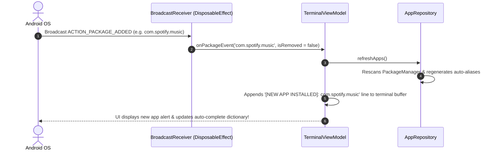
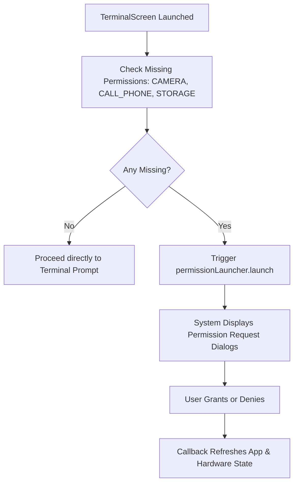

# 📖 Chapter 8: System Events & Dynamic Broadcast Receivers

---

## 🎯 Chapter Overview & Learning Objectives

Welcome to **Chapter 8** of *The Art of Android Shells: Building Terminal Launcher from Scratch*.

In this chapter, you will learn how a Home Screen Launcher responds to system-level Android events in real-time. A launcher must detect when the user installs or uninstalls applications so its app index updates immediately without requiring a manually triggered refresh. Furthermore, you will learn how to handle modern Android runtime permission requests using Jetpack Compose `ActivityResultContracts`.

By the end of this chapter, you will understand:
1. How to listen for system-wide broadcast events (`PACKAGE_ADDED`, `PACKAGE_REMOVED`) inside Jetpack Compose using `DisposableEffect`.
2. How to clean up broadcast receivers safely on composable disposal to prevent Context memory leaks.
3. How to execute runtime permission checks using `ActivityResultContracts.RequestMultiplePermissions`.

---

## 8.1 Listening to Package Events with `DisposableEffect`

When a user downloads a new app from the Google Play Store or uninstalls an existing application, the Android system dispatches implicit system broadcasts: `Intent.ACTION_PACKAGE_ADDED` and `Intent.ACTION_PACKAGE_REMOVED`.

In [TerminalScreen.kt](file:///home/mohammed/StudioProjects/Terminal-Launcher/app/src/main/java/com/example/terminallauncher/ui/TerminalScreen.kt#L91-L113), Terminal Launcher registers a dynamic `BroadcastReceiver` bound to the lifecycle of the `TerminalScreen` composable via `DisposableEffect`:

```kotlin
// Dynamic Package Event BroadcastReceiver (Detect app installs & uninstalls)
DisposableEffect(context) {
    val receiver = object : BroadcastReceiver() {
        override fun onReceive(ctx: Context?, intent: Intent?) {
            val action = intent?.action ?: return
            val pkgName = intent.data?.schemeSpecificPart ?: return
            when (action) {
                Intent.ACTION_PACKAGE_REMOVED -> viewModel.onPackageEvent(pkgName, isRemoved = true)
                Intent.ACTION_PACKAGE_ADDED -> viewModel.onPackageEvent(pkgName, isRemoved = false)
            }
        }
    }

    val filter = IntentFilter().apply {
        addAction(Intent.ACTION_PACKAGE_ADDED)
        addAction(Intent.ACTION_PACKAGE_REMOVED)
        addDataScheme("package") // CRITICAL: Package events require the "package" data scheme!
    }
    context.registerReceiver(receiver, filter)

    // Automatically unregister receiver when the composable leaves the composition
    onDispose {
        try {
            context.unregisterReceiver(receiver)
        } catch (_: Exception) {}
    }
}
```



### Why `DisposableEffect` is Essential:
If a developer registers a `BroadcastReceiver` inside a standard composable function without `DisposableEffect`, two critical bugs occur:
1. Every recomposition re-registers duplicate instances of the receiver, causing multiple duplicate event triggers.
2. When the user navigates away, the receiver remains registered in Android's `ActivityManager`, leaking memory.

`DisposableEffect` guarantees that `registerReceiver` is called **once** when entering the composition, and `onDispose { unregisterReceiver }` cleans up the receiver when leaving!

---

## 8.2 Dynamic Permission Requests in Compose

Terminal Launcher offers commands like `sys flash` (toggle flashlight camera permission) and `call <number>` (direct dial call phone permission). On Android 6.0+ (API 23+), sensitive permissions must be requested dynamically at runtime.

In [TerminalScreen.kt](file:///home/mohammed/StudioProjects/Terminal-Launcher/app/src/main/java/com/example/terminallauncher/ui/TerminalScreen.kt#L69-L88), runtime permission requests are handled using `rememberLauncherForActivityResult`:

```kotlin
// First-run runtime permissions check
val permissionsToRequest = remember {
    val list = mutableListOf(Manifest.permission.CAMERA, Manifest.permission.CALL_PHONE)
    if (Build.VERSION.SDK_INT <= Build.VERSION_CODES.S_V2) {
        list.add(Manifest.permission.READ_EXTERNAL_STORAGE)
    }
    list
}

val permissionLauncher = rememberLauncherForActivityResult(
    contract = ActivityResultContracts.RequestMultiplePermissions()
) { permissionsMap ->
    // Refresh app list and hardware capability status after permission response
    viewModel.refreshApps()
}

LaunchedEffect(Unit) {
    val missingPermissions = permissionsToRequest.filter {
        ContextCompat.checkSelfPermission(context, it) != PackageManager.PERMISSION_GRANTED
    }
    if (missingPermissions.isNotEmpty()) {
        permissionLauncher.launch(missingPermissions.toTypedArray())
    }
}
```



---

## 📝 Summary & Key Takeaways

1. **System Events**: `ACTION_PACKAGE_ADDED` and `ACTION_PACKAGE_REMOVED` allow Terminal Launcher to maintain an up-to-date app index in real-time.
2. **`DisposableEffect` Clean Up**: Automatically registers the `BroadcastReceiver` on composition and unregisters it on disposal, preventing memory leaks.
3. **Data Scheme Requirement**: Package event intent filters require `addDataScheme("package")` to receive system package notifications.
4. **Runtime Permissions**: `rememberLauncherForActivityResult` with `RequestMultiplePermissions` handles non-blocking permission requests in Compose.

---

## ❓ Chapter 8 Self-Assessment Exercises

1. What happens if you omit `addDataScheme("package")` when creating an `IntentFilter` for `ACTION_PACKAGE_ADDED`?
   * *Answer*: Android OS will fail to deliver package events to the receiver because package broadcasts carry a `package:` URI scheme payload.
2. Why should `unregisterReceiver` be wrapped in a `try-catch` block inside `onDispose`?
   * *Answer*: Wrapping unregister in `try-catch` prevents app crashes if the system or Activity has already unregistered the receiver prior to composable disposal.

---

👉 **Next Step**: Proceed to [Chapter 9: Automated Testing, Compilation & Deployment Workflow](file:///home/mohammed/StudioProjects/Terminal-Launcher/docs/CHAPTER_9.md) to explore unit testing, Gradle CLI builds, and ADB deployment!
