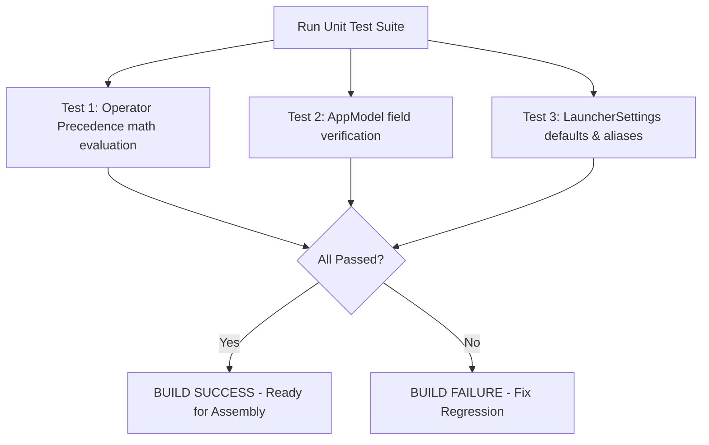
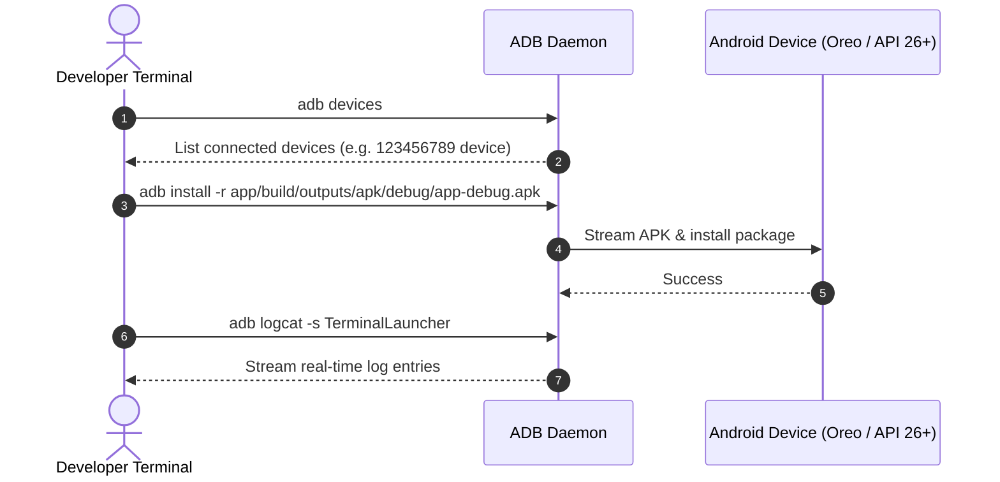

# 📖 Chapter 9: Automated Testing, Compilation & Deployment Workflow

---

## 🎯 Chapter Overview & Learning Objectives

Welcome to **Chapter 9** of *The Art of Android Shells: Building Terminal Launcher from Scratch*.

In this final chapter, you will master the end-to-end engineering workflow for building, testing, and deploying Terminal Launcher. You will explore unit testing algorithms in isolation using **JUnit 4**, running Gradle build tasks from the command line interface (CLI), and deploying APK binaries to real hardware devices and emulators using **Android Debug Bridge (ADB)**.

By the end of this chapter, you will understand:
1. How to write unit tests for mathematical expression evaluation and domain models in [CommandEngineTest.kt](file:///home/mohammed/StudioProjects/Terminal-Launcher/app/src/test/java/com/example/terminallauncher/CommandEngineTest.kt).
2. How to execute Gradle build tasks (`assembleDebug`, `testDebugUnitTest`) via CLI.
3. How to deploy and debug APKs on hardware devices using ADB (`adb install`, `adb logcat`).

---

## 9.1 Unit Testing with JUnit 4

Testing business logic in isolation ensures that changes to the command parser or algorithm implementations do not introduce regressions.

In [CommandEngineTest.kt](file:///home/mohammed/StudioProjects/Terminal-Launcher/app/src/test/java/com/example/terminallauncher/CommandEngineTest.kt), unit tests verify mathematical expression parsing and model defaults:

```kotlin
class CommandEngineTest {

    @Test
    fun testMathExpressionEvaluation() {
        val expr1 = "12 + 8 * 2"
        val expr2 = "(100 - 20) / 4"
        val expr3 = "2 ^ 3"

        val val1 = evaluateMath(expr1)
        val val2 = evaluateMath(expr2)
        val val3 = evaluateMath(expr3)

        assertEquals(28.0, val1, 0.001)
        assertEquals(20.0, val2, 0.001)
        assertEquals(8.0, val3, 0.001)
    }

    @Test
    fun testAppModelAndSettingsDefaults() {
        val app = AppModel("YouTube", "com.google.android.youtube", "com.google.android.youtube.MainActivity")
        assertEquals("YouTube", app.label)
        assertEquals("com.google.android.youtube", app.packageName)

        val settings = LauncherSettings()
        assertEquals(TerminalThemeType.CRT_GREEN, settings.theme)
        assertTrue(settings.fastfetchOnStart)
        assertTrue(settings.autocompleteEnabled)
        assertEquals("YouTube", settings.aliases["yt"])
        assertEquals(15, settings.textSizeSp)
        assertEquals(AsciiArtStyle.DEFAULT, settings.asciiArtStyle)
    }
}
```



---

## 9.2 Command Line Build Commands (`./gradlew`)

While Android Studio provides GUI build buttons, production continuous integration (CI) pipelines and command-line developers rely on the Gradle Wrapper script (`./gradlew`).

### Essential CLI Gradle Commands:

```bash
# 1. Clean build cache and temporary build outputs
./gradlew clean

# 2. Run unit test suite
./gradlew testDebugUnitTest

# 3. Compile and assemble Debug APK binary
./gradlew app:assembleDebug

# 4. Compile and assemble optimized Release APK binary
./gradlew app:assembleRelease
```

### Build Artifact Locations:
* Debug APK: `app/build/outputs/apk/debug/app-debug.apk`
* Release APK: `app/build/outputs/apk/release/app-release-unsigned.apk`

---

## 9.3 Deploying & Debugging via ADB (Android Debug Bridge)

Once the debug APK is compiled, developers deploy the application to connected Android devices or emulators using **ADB**.



### ADB Command Line Reference:

```bash
# Check connected devices and emulators
adb devices

# Install debug APK (-r reinstalls and keeps app data)
adb install -r app/build/outputs/apk/debug/app-debug.apk

# Launch Terminal Launcher MainActivity directly via ADB shell
adb shell am start -n com.example.terminallauncher/.MainActivity

# Filter logcat output specifically for Terminal Launcher logs
adb logcat -s TerminalLauncher:V

# Force-stop Terminal Launcher process
adb shell am force-stop com.example.terminallauncher
```

---

## 📝 Summary & Key Takeaways

1. **Unit Testing**: Isolated unit tests in `app/src/test` verify math evaluation algorithms and domain model defaults without booting an Android device emulator.
2. **Gradle CLI**: `./gradlew app:assembleDebug` and `./gradlew testDebugUnitTest` automate builds for local environments and CI pipelines.
3. **ADB Deployment**: `adb install -r` streams compiled APK binaries directly to physical hardware phones or emulators for instant testing.

---

## ❓ Chapter 9 Self-Assessment Exercises

1. Why are local unit tests (`src/test`) significantly faster than instrumentation tests (`src/androidTest`)?
   * *Answer*: Local unit tests execute directly on the local JVM (Java Virtual Machine), whereas instrumentation tests require booting an Android Virtual Device (AVD) or physical device to run inside the Android OS environment.
2. What does the `-r` flag do in `adb install -r`?
   * *Answer*: Reinstalls an existing app package while preserving user settings and data (e.g., DataStore preferences and custom aliases).

---

🎉 **Congratulations!** You have completed all 9 chapters of *The Art of Android Shells: Building Terminal Launcher from Scratch*! You now possess the complete architecture, build system, state management, and command interpreter skills needed to design, develop, and deploy production-grade Android shells!
